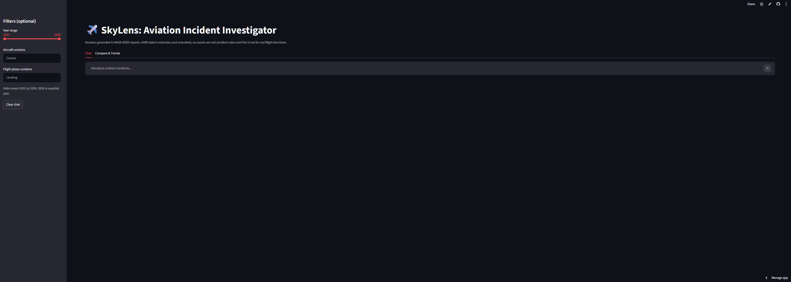
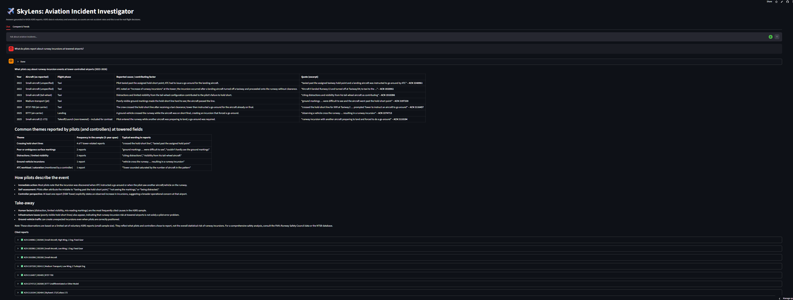
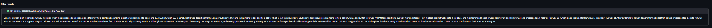
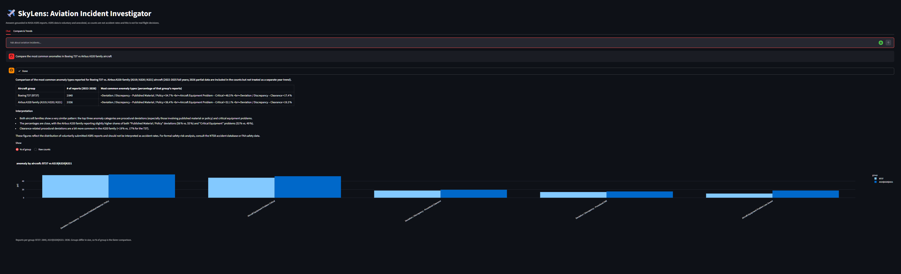
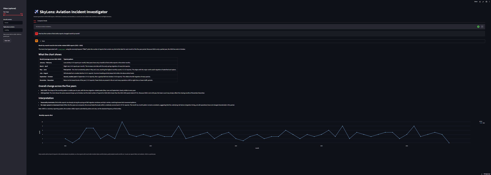
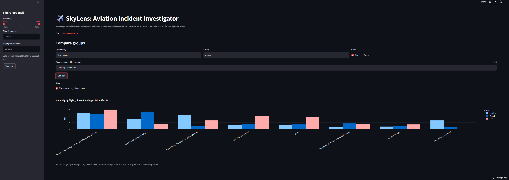
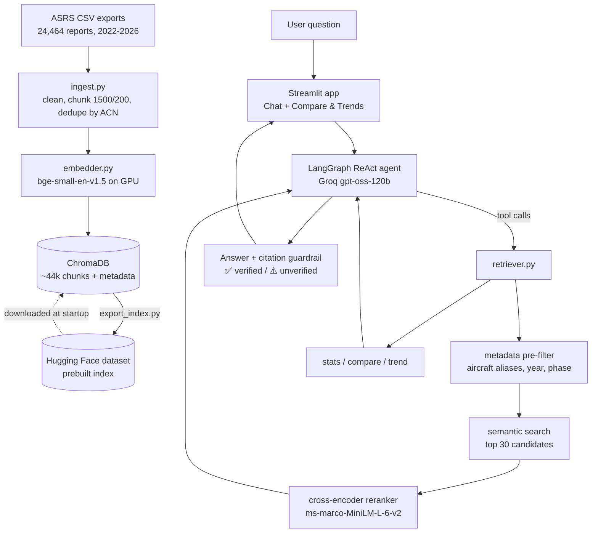

# SkyLens: Aviation Incident Investigator Agent

**An agentic RAG system that answers questions about 24,464 NASA aviation safety reports, with verifiable citations, comparison charts and a measured evaluation.**

**[▶ Try the live app](https://skylens-aviation-incident-investigator-agent-rmxzmymmg9fnodtmg.streamlit.app/)** · Python · LangGraph · ChromaDB · sentence-transformers · Groq (gpt-oss-120b) · Streamlit



---

## What it does

SkyLens works over the NASA **Aviation Safety Reporting System (ASRS)**, where pilots, controllers and technicians voluntarily describe safety incidents. Ask a question in plain English and an AI agent:

1. **Decides which tools to use:** search reports, read a full report, count statistics, or draw a chart.
2. **Retrieves evidence:** metadata filters (aircraft, flight phase, year), semantic search, then a cross-encoder reranker.
3. **Answers with citations** like `ACN 1892506`. Each citation opens the full report and is marked ✅ only if the agent actually retrieved it.
4. **Stays honest:** writes "cause not stated" when a report gives no cause, labels general knowledge separately, flags small samples, and never treats "no matching filter" as "it never happened".

There is also a **Compare & Trends** tab that draws comparison and trend charts directly from the data, without calling the LLM.

## Screenshots

| | |
|---|---|
|  |  |
| **Grounded answer** with ✅ verified citations | **Every citation opens** the full original report |
|  |  |
| **Agent reasoning** shown live (tool calls and arguments), with a comparison chart | **Trend chart** drawn by the agent from a chat question |
|  | |
| **Compare & Trends tab:** no LLM, % of group toggle for fair comparison | |

## Results at a glance

| What was measured | Result |
|---|---|
| Retrieval precision@5, 21 questions incl. 8 paraphrased "hard" ones | **0.90 → 0.95** after adding a 22M-parameter reranker |
| Best setup vs an embedding model about 18× larger (Qwen3-0.6B) | **0.95 vs 0.94**, at about 1/11 of the build time |
| Agent answers with citations | **13/13** |
| Citations not backed by a retrieved report | **1/13**, caught by the check and flagged in the UI |
| Statistics answers matching ground truth | **4/4** |
| Index build on GPU vs CPU | **4.7 min vs about 35-40 min** (RTX 3050) |

Full numbers and how they were measured: [Evaluation](#evaluation).

## Architecture



### Agent tools

| Tool | Purpose |
|---|---|
| `search_reports` | Filtered semantic search plus reranking, one result per report |
| `get_report` | Full text of one report by ACN |
| `stats_summary` | Counts and "most common" questions, computed from metadata (not guessed by the LLM) |
| `compare_groups` | Compares 2-4 groups (aircraft, phase, state, year) and draws a bar chart |
| `trend_chart` | Monthly report counts as a line chart |

## Dataset

- **Source:** [NASA ASRS Database Online](https://asrs.arc.nasa.gov/search/database.html), exported as CSV.
- **Size:** 24,464 unique reports: 2022: 5,451 · 2023: 4,590 · 2024: 5,427 · 2025: 6,127 · 2026 (partial): about 2,869.
- **Fields used:** report ID (ACN), date, aircraft, flight phase, anomaly labels, state, time of day, synopsis and narratives.

**What the data is and isn't:** ASRS reports are voluntary and de-identified. A higher count means **more reports filed**, not more danger. The exact aircraft model is often withheld: the most common "aircraft" values are generic, like *Commercial Fixed Wing* (3,200 reports) or *Small Aircraft*, so aircraft comparisons only cover reports where the model is named.

## Evaluation

```powershell
python eval\run_eval.py --no-agent   # retrieval only: precision@5 and search time
python eval\run_eval.py              # full run including the agent
```

**Metrics:** keyword precision@5 (share of the top 5 reports containing an expected keyword), average search time, fabricated citations (a cited ACN that no tool returned), and statistics accuracy against counts computed directly from the data.

### 1. A harder test set

The first 13 questions **saturated** (0.98), so they couldn't tell models apart. I added 8 paraphrased questions that describe an event without its usual keyword (for example *"pilot set the wrong barometric pressure"* instead of *"altimeter setting"*), then froze the set before comparing models. Re-running the baseline reproduced the same per-question scores, so the evaluation is deterministic.

### 2. Embedding models (no reranker)

| Model | Original 13 | All 21 | Build time (RTX 3050) |
|---|---|---|---|
| bge-small (384-dim) | 0.98 | 0.90 | 4.7 min |
| bge-base (768-dim) | 1.00 | 0.93 | 9.0 min |
| Qwen3-Embedding-0.6B (1024-dim) | 1.00 | 0.94 | 51.7 min |

### 3. Rerankers (on top of bge-small)

| Setup | All 21 | Hard Q18 / Q19 / Q22 / Q23 / Q25 | Avg search time |
|---|---|---|---|
| No reranker | 0.90 | 0.4 / 0.6 / 1.0 / 1.0 / 0.0 | 254 ms |
| **+ ms-marco-MiniLM-L-6-v2 (22M)** | **0.95** | 0.8 / 1.0 / 1.0 / 0.8 / 0.4 | 458 ms |
| + bge-reranker-base (278M) | 0.91 | 0.8 / 0.6 / 0.8 / 1.0 / 0.0 | about 5 s* |

\*Measured while another run shared the GPU, so the time is inflated. The accuracy result stands regardless.

**Decision:** bge-small + MiniLM reranker. It scored best overall, costs about 200 ms per search, builds in under 5 minutes and runs on a CPU-only free host. The 12× larger reranker was *not* better. Only Qwen3 really fixes question 25 (0.8). With 21 questions, differences of about 0.01 are noise.

### 4. Agent (Groq gpt-oss-120b)

| Metric | Result |
|---|---|
| Answers with at least one citation | 13/13 |
| Answers citing an ACN that no tool returned | 1/13: the model wrote `ACN 202305`, a mangled ID. Caught by the check and flagged in the UI. |
| Statistics answers matching ground truth | 4/4 |

The citation check confirms that a cited report was retrieved. It does not prove the claim matches the report text, so it is a lower bound on hallucination, not a full faithfulness score.

## Engineering notes: problems found and fixed

**Retrieval**
- **Rare aircraft were missed.** "Boeing 787 landing gear" returned *no reports* although 256 B787 reports exist: filtering the top 500 chunks *after* search left nothing. Search now pre-filters by metadata first, then searches inside the matching reports.
- **Aircraft naming.** Users write "Boeing 787", "Piper" or "Cessna", but ASRS stores `B787`, `PA-28` and `Skyhawk 172`. Cessna comparisons were missing the 1,260 Skyhawk reports, and Piper counted 21 reports instead of 1,021. Fixed with brand-to-model aliases.
- **Semantic confusion.** "Wrong barometric pressure" retrieved cabin-pressure and engine-pressure reports (precision 0.0): the model matched the word, not the meaning. A reranker raised it to 0.4, and Qwen3 to 0.8.
- **Scale.** At about 44k chunks, one big metadata query failed ("too many SQL variables"). Fixed with paged loading and an in-memory cache.

**Answer quality and grounding**
- **Invented causes.** The same report got two different made-up causes on two runs. The agent must now write "cause not stated" and label general knowledge separately.
- **"No match" read as "no incidents".** Filtering for "Bird Strike" (ASRS says *"Encounter Bird / Animal"*) matched nothing, and the agent concluded there were *zero bird strikes in five years*. The chart tools now report empty filters with real label suggestions, and the agent retries.
- **Citation guardrail.** Every cited ACN is checked against what the tools actually returned (✅ / ⚠️).
- **Misleading statistics.** Co-occurring anomaly labels were presented as sub-types, and a 21-report sample was used for fleet advice. Fixed with tool wording and small-sample rules.
- **Mislabelled groups.** "A320 family" was counted as A320 only (738 vs about 2,036 reports). The agent now maps it to `A319|A320|A321`.

**LLM and agent**
- **Hallucinated tool.** gpt-oss called a tool that doesn't exist (`repo_browser.open_file`). Fixed with a tool allow-list and one automatic retry.
- **Free tier, 8,000 tokens per minute.** Requests were too large (413 errors). Chart data is now kept out of the LLM context (the model sees a short summary), and snippets and history are trimmed.
- **Context leaks.** A failed turn or a previous question bled into the next answer. Failed turns are now excluded, and each question is treated as standalone.

**Data and infrastructure**
- **Stray dates.** A few reports carry incident dates from 2002 or 2015, which stretched the trend axis. Trends now plot only well-covered months.
- **GPU.** The default Windows install ran PyTorch on the CPU. The CUDA build made indexing about 8× faster.
- **Deployment pivot.** Hugging Face moved Docker Spaces behind a paid plan, so the app runs on **Streamlit Community Cloud** (free) and downloads the prebuilt index from a **Hugging Face dataset** at startup.
- **Secrets hygiene.** A key file was found in an unpushed commit before it reached GitHub. Keys now live only in environment variables and app secrets.

## Run it locally

Run every command from the project root.

```powershell
python -m venv .venv
.venv\Scripts\activate
python -m pip install -r requirements.txt          # requirements-local.txt = full GPU setup used for development
$env:GROQ_API_KEY="your-key"                       # free key from console.groq.com
```

**Either** download the prebuilt index, which happens automatically:
```powershell
$env:INDEX_REPO="R0vell/skylens-index"
streamlit run app.py
```
**or** build it yourself from ASRS CSV exports placed in `data/`:
```powershell
python src\ingest.py
streamlit run app.py
```

Options: `EMBED_MODEL` = `bge-small` (default), `bge-base` or `qwen3-0.6b`. `RERANKER` = `minilm` (default), `bge` or `none`. `LLM_MODEL` = any Groq model your key can use.

## Deployment

- **App:** Streamlit Community Cloud, deployed from this repo. `GROQ_API_KEY` and `INDEX_REPO` are set as app secrets.
- **Index:** `src/export_index.py` copies only the bge-small collection (about 493 MB) into `deploy_db/`, which is uploaded as the Hugging Face dataset [`R0vell/skylens-index`](https://huggingface.co/datasets/R0vell/skylens-index).
- **Docker:** a `Dockerfile` (CPU-only torch) is included to run the app anywhere.

## Project structure

```
├── app.py                  # Streamlit UI: chat, citations, guardrail, Compare & Trends
├── src/
│   ├── ingest.py           # load, clean, chunk, embed, store
│   ├── embedder.py         # embedding model config (model, prompts, device)
│   ├── retriever.py        # pre-filter, search, rerank, stats, compare, trend, aliases
│   ├── agent.py            # LangGraph agent, 5 tools, grounding rules
│   ├── charts.py           # Plotly charts and the Compare tab
│   ├── export_index.py     # export the deployable index
│   └── test.py             # quick retrieval check
├── eval/
│   ├── questions.json      # 25 questions (21 retrieval, 4 statistics)
│   ├── run_eval.py         # evaluation script
│   └── results.json        # last run
├── docs/screenshots/       # images used in this README
├── Dockerfile
├── requirements.txt        # deployment (CPU) dependencies
└── requirements-local.txt  # full local development environment (GPU)
```

## Limitations

- Keyword precision is a lenient metric, and 21 questions is a small set. Differences of about 0.01 are noise.
- The citation check proves a report was retrieved, not that every claim matches it.
- ASRS is voluntary and de-identified: counts reflect reporting, not risk, and many reports don't name the aircraft model.
- Filters work by year, not month. The free LLM tier limits speed when questions come back to back.

## Future work

- An LLM-as-judge faithfulness check (claim vs cited text)
- Hybrid BM25 + vector search for exact terms like "TCAS RA"
- Month-level filters, and NTSB accident data as a second source

## Data note

ASRS data is published by NASA. Raw CSVs are not included in this repository.
